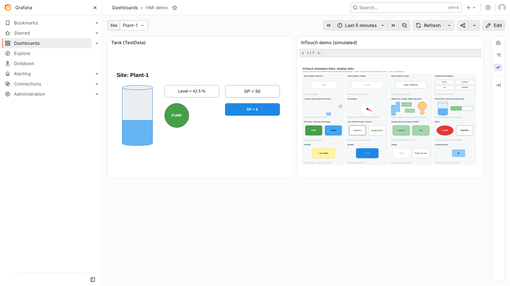
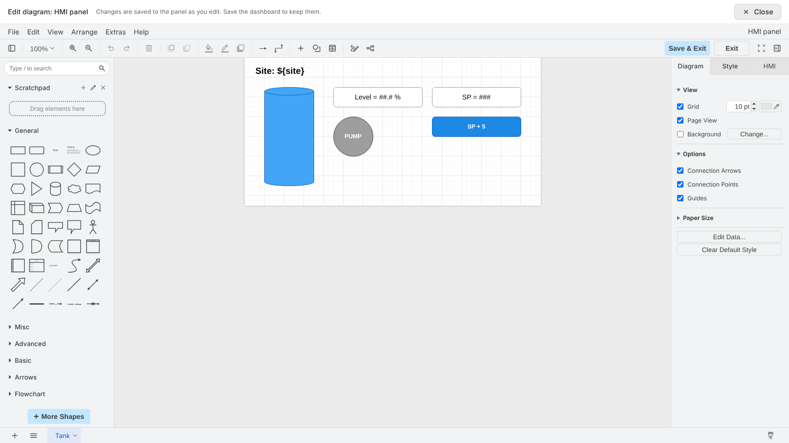

# Grafana HMI

Grafana plugins that run [draw.io HMI/SCADA screens](https://github.com/softalink/drawio/tree/main/docs/hmi) on Grafana data:

| Plugin | Id | What it does |
| --- | --- | --- |
| HMI panel | `softalink-hmi-panel` | Runs a screen in the dashboard with the lightweight HMI runtime (`hmi-viewer.min.js`, about 0.8 MB gzipped), no iframe. Query results drive the screen's tags. |
| HMI Editor app | `softalink-hmieditor-app` | Static files only: the draw.io editor with the HMI plugin (about 115 MB on disk). The panel opens it in panel edit. |



## How it works

- **Viewing.** The first HMI panel on a page loads `public/plugins/softalink-hmi-panel/drawio/js/hmi-viewer.min.js` once. Each panel creates a draw.io `GraphViewer` with the HMI runtime attached (`Hmi.Viewer.attach`, key equivalents scoped to the panel), scales the screen to the panel, and removes it with `Hmi.Viewer.detach` when the panel unmounts.
- **Data.** Each field of the query results is a tag, named after its display name (or renamed by **Tag mapping**). Its last non-null value, with the time of that row, goes to the runtime as a host value.
- **Editing.** In panel edit, **Edit diagram** opens `public/plugins/softalink-hmieditor-app/editor/index.html?embed=1&proto=json&p=hmi` in a full-viewport overlay (iframe), or in a separate window when Grafana forbids framing. The panel and the editor talk with draw.io's embed protocol (`init`, `load`, `autosave`, `save`, `exit`) and the HMI messages (`hmiReady`, `hmiSetHostTags`, `hmiSetValues`, `hmiWrite`). Every change is autosaved into the panel option; saving the dashboard keeps it.
- **Writes.** A touch link or script that writes a tag of a **host** data source of the screen makes the runtime emit `hostWrite`. With **Writes: HTTP POST**, the panel posts `{tag, value, dashboardUid, panelId}` to the **Write URL** through Grafana, for users with at least the **Minimum role for writes**.

The design is in the doc *Grafana HMI Panel: iframe editor design*.



## Requirements

- Grafana 12.1 or later (tested with 12.1.1 and 13.2.2).
- Node 22 to build.

Nothing else: the draw.io files both plugins need are in `vendor/drawio` (see [Updating draw.io](#updating-drawio)).

## Building

```sh
(cd panel && npm install)
npm run build        # panel (webpack) + editor app + copies vendor/drawio into both
```

Building only the panel (`npm --prefix panel run build`) clears `panel/dist`; run `npm run copy-drawio` after it.

## Updating draw.io

`vendor/drawio` is a trimmed build of [softalink/drawio](https://github.com/softalink/drawio) (the editor with the HMI plugin, and the HMI runtime `js/hmi-viewer.min.js`). `vendor/drawio/VERSION.json` names the branch and commit it came from. To update it:

```sh
git clone -b <branch> https://github.com/softalink/drawio.git ../drawio
(cd ../drawio/etc/build && ant app)
npm run update-drawio -- ../drawio/src/main/webapp
npm run make-dashboard   # the demo dashboard embeds the demo template
npm run build
```

The update leaves out what neither plugin uses: development sources, integrations, cloud and desktop code, the service worker, server-side files and the other viewer bundles.

## Running locally

```sh
docker compose up -d        # Grafana 13.2.2 on http://localhost:3000 (admin / admin)
GRAFANA_VERSION=12.1.1 docker compose up -d
```

The compose file mounts both `dist` folders as plugins, allows them unsigned, turns `allow_embedding` on and provisions the **HMI demo** dashboard (`scripts/make-dashboard.mjs`): a tank screen fed by TestData and the InTouch demo template.

## Installing

1. Copy `panel/dist` to `<plugins>/softalink-hmi-panel` and `editor-app/dist` to `<plugins>/softalink-hmieditor-app`.
2. Unsigned plugins must be allowed: `[plugins] allow_loading_unsigned_plugins = softalink-hmi-panel,softalink-hmieditor-app` (or sign them).
3. For the editor overlay, allow framing. Grafana sends `X-Frame-Options: deny` on every response unless `[security] allow_embedding = true`. That setting also lets other sites frame Grafana, so restrict it to Grafana itself with a content security policy (`content_security_policy = true` and `frame-ancestors 'self'` in `content_security_policy_template`). Without it, the panel opens the editor in a separate window (option **Advanced > Editor: Auto**).

## Panel options

| Option | Default | Meaning |
| --- | --- | --- |
| Diagram | empty | The screen (mxfile XML). Edit diagram, Load demo, Import and Download. |
| Fit | Page | Page, Width or None (actual size, scrolls). |
| Simulation | Diagram setting | The screen's simulated tags: Off, On (alongside its own data sources) or Only (no connections). |
| Data > Tag mapping | empty | One `grafana name = tag name` per line. |
| Data > Apply dashboard variables | on | Replaces `${variable}` in the screen. |
| Writes > Writes | Off | Off or HTTP POST to the Write URL. |
| Writes > Write URL | empty | Relative to Grafana or absolute; variables allowed. |
| Writes > Minimum role for writes | Editor | Viewer, Editor or Admin. |
| Advanced > Editor | Auto | Overlay, Window, or Auto (overlay when Grafana allows framing). |
| Advanced > Editor URL | the editor app | Where the editor page is served. |

## Testing

```sh
npm test                                     # Jest: data bridge, editor protocol, framing check
docker compose up -d && npm run e2e          # Playwright in Grafana: overlay mode
GF_SECURITY_ALLOW_EMBEDDING=false docker compose up -d
HMI_EDITOR_MODE=window npm run e2e           # window mode
```

The end-to-end tests check the tank screen's values, the pump colour and variables; the demo's simulation; a variable change remounting without leaking viewers; writes with the URL, body and role check; the editor receiving the Grafana tags, keeping Esc away from Grafana, autosaving into the preview and closing; and that a Viewer cannot write. Set `CHROMIUM_PATH` to use an installed Chromium.

## Repository layout

```
panel/          the panel plugin (scaffolded with @grafana/create-plugin)
  src/runtime/  loader (hmi-viewer.min.js), viewer wrapper, writes
  src/editor/   Edit diagram option, overlay, window, protocol session
  tests/        Playwright tests
editor-app/     the editor app plugin (plugin.json, module.js)
scripts/        build-editor-app, copy-drawio, make-dashboard, update-drawio
vendor/drawio/  the draw.io build both plugins use
provisioning/   TestData data source, editor app, HMI demo dashboard
```

## Open points

- Signing and a release workflow (the plugins are unsigned).
- Trimming the editor app (it ships the whole draw.io app, including all shape libraries).
- Storing large diagrams outside the dashboard JSON (a `.drawio` URL option).
